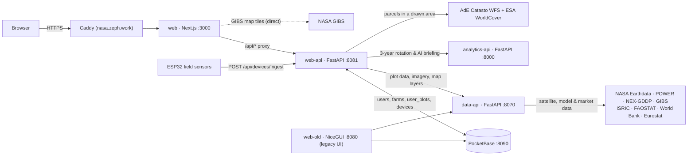

# 🚀 NASA Space Apps Challenge 2026 — Adapting Farms with NASA Data

Decision support for farmers: pick a field from the Italian cadastre (or draw one), see what NASA and partner
datasets say about it (weather, water, soil, terrain, crop history, climate projections, prices, satellite
images), plug in on-field sensors, and compare crop rotations and their profit.

Live demo: **https://nasa.zeph.work**

### 🌟 Authors

- [zeph](https://github.com/ZephyrCodesStuff)
- [ardalc](https://github.com/ardlc-1212)
- [erengrl](https://github.com/erengrl)
- [CoderXYZ7](https://github.com/CoderXYZ7)

## 🏗️ Architecture



| Service | Folder | Port | What it does |
|---|---|---|---|
| `web` | [`web/app`](web/app) | 3000 (localhost, behind Caddy) | Next.js UI: map workbench, farms and plots, and 4-tab plot workspace (**Field & Map**, **Water, Soil & Climate**, **Rotation Plan**, **Markets & Costs**). `/api/*` is proxied to `web-api`. |
| `web-api` | [`api/web-api`](api/web-api) | 8081 | REST backend: auth, farms, plots, catasto parcel discovery, plot analysis, IoT devices. Relays `data-api` and `analytics-api` for a user's plot. |
| `data-api` | [`api/data-api`](api/data-api) | 8070 (internal only) | Returns everything we know about a field boundary: 15 datasets, satellite images in many bands, map layers. See [its README](api/data-api/README.md). |
| `analytics-api` | [`api/analytics-api`](api/analytics-api) | 8000 (internal only) | Field ingestion parser, deterministic 3-year crop rotation optimizer, and plain-language AI briefing (with deterministic fallback). |
| `pocketbase` | [`pocketbase`](pocketbase) | 8090 (internal only) | Database and auth. Schema in [`pocketbase/pb_migrations`](pocketbase/pb_migrations). |
| `web-old` | [`web/app-old`](web/app-old) | 8080 (internal only) | The first NiceGUI version of the UI, kept for reference. |

## ⚡ Quick start

```bash
cp .env.example .env          # add a free NASA Earthdata login (https://urs.earthdata.nasa.gov) and optional GEMINI_API_KEY
docker compose up --build -d
```

- Website: http://localhost:3000 (demo login: `marco@turinfarm.it` / `demo-farmer-2026`)
- web-api docs: http://localhost:8081/docs

The Earthdata account must also authorise the **NASA GESDISC DATA ARCHIVE** application (for IMERG rainfall).
Without a login most NASA datasets return `error`. The data-api saves it on its cache volume, so later
redeploys keep working.

Local development per service: see the README in each folder (`data-api`: `uv run uvicorn app.main:app --port 8070`,
`web`: `bun dev`).

## 🛰️ Data we can get for a field

Full field-by-field reference: [docs/data-catalog.md](docs/data-catalog.md) (spreadsheet:
[docs/data-catalog.csv](docs/data-catalog.csv)). How the web app calls it: [docs/data-api-for-web.md](docs/data-api-for-web.md).

- **Weather & climate:** temperature, humidity, dew point, wind, solar radiation, daylight hours, growing degree days,
  1991–2020 normals, extremes of the last 12 months, and every series summarised into **24 half-month periods**.
- **Water:** satellite rainfall, soil moisture (surface and root zone), crop evapotranspiration and water-stress
  index (field 70 m and area 500 m), regional groundwater.
- **Crop:** NDVI / NDMI / NDRE and field patchiness (30 m), and **the crop grown in each of the last 5 years**,
  read from the season's vegetation curve.
- **Soil & terrain:** texture, organic carbon, pH, nitrogen, CEC, bulk density; elevation, slope, field gradient,
  aspect, low spots; **RUSLE erosion risk**.
- **Future:** 2030s and 2050s rain, heat, dry spells, water balance and **drought risk** (CMIP6, two scenarios).
- **Prices:** Italian farm-gate crop prices, electricity, gas and diesel; world oil, fertiliser and grain prices;
  national yields and production (FAOSTAT).
- **Images:** true colour, colour infrared, SWIR, NDVI, NDMI, NDRE, thermal, surface temperature, elevation,
  hillshade, slope, plus NASA GIBS map layers (rain, soil moisture, vegetation, temperature, relief).
- **On the field:** ESP32 sensor readings (soil moisture, humidity, temperature), posted to `web-api`.

Not available from public sources (farmer input): seed prices, irrigation water price and connection, exact crop species.

## 📁 Repository layout

```
api/
  data-api/        NASA + global datasets for a field (FastAPI)
  web-api/         backend for the website (FastAPI)
  analytics-api/   ingestion parser + rotation optimizer
web/
  app/             Next.js website
  app-old/         first NiceGUI UI
pocketbase/
  pb_migrations/   database schema
docs/              data catalog, how the web app uses data-api
compose.yaml       all services
```

## 📚 Data sources & credits

**NASA**
- NASA POWER (daily and climatology) — NASA Langley Research Center POWER Project
- GPM IMERG Late Run V07 — NASA GES DISC
- SMAP L4 Global 3-hourly 9 km Surface and Root Zone Soil Moisture (SPL4SMGP) — NASA NSIDC DAAC
- ECOSTRESS v2 (L2T LSTE, L3T JET, L4T ESI) — NASA LP DAAC
- Harmonized Landsat Sentinel-2 (HLS) v2.0 — NASA LP DAAC
- MODIS MOD16A2 v6.1 — NASA LP DAAC, via ORNL DAAC MODIS Web Service
- NASADEM_HGT v001 — NASA LP DAAC
- GRACE/GRACE-FO JPL Mascon RL06.3 CRI — NASA JPL / PO.DAAC
- NEX-GDDP-CMIP6 — NASA Center for Climate Simulation (NCCS)
- Global Imagery Browse Services (GIBS) — NASA EOSDIS

**Partners & other open data**
- ISRIC SoilGrids 2.0 — ISRIC World Soil Information (CC BY 4.0)
- Cartografia catastale — Agenzia delle Entrate (CC BY 4.0)
- ESA WorldCover — European Space Agency (CC BY 4.0)
- FAOSTAT — Food and Agriculture Organization of the United Nations
- World Bank Commodity Price Data (Pink Sheet)
- Eurostat; EU Weekly Oil Bulletin — European Commission
- OpenStreetMap (Nominatim) — © OpenStreetMap contributors (ODbL)
- Basemap imagery — Esri World Imagery

Formulas: FAO-56 water balance, RUSLE (Renard et al.), EPIC soil erodibility (Williams), Hargreaves reference ET.

Recommendations are advisory and support, not replace, local agronomist and farmer judgment.

## 📄 License

Dual-licensed under [Apache 2.0](LICENSE-APACHE) and [MIT](LICENSE-MIT).
