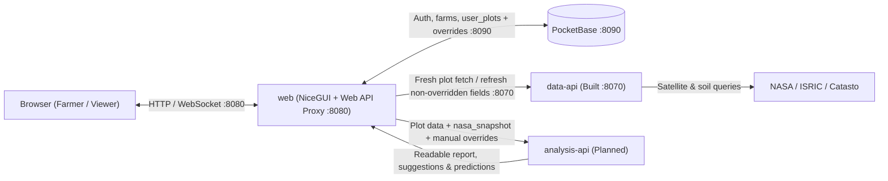

# 🚀 NASA Space Apps Challenge 2026

Monorepo for the NASA Space Apps Challenge 2026 hackathon.

### 🌟 Authors

- [zeph](https://github.com/ZephyrCodesStuff)
- [ardalc](https://github.com/ardlc-1212)
- [erengrl](https://github.com/erengrl)

### 🗒️ Contents

- Web frontend 🌐
- Dockerfiles 🐳
- Everything your heart most desires ❤️

### 🏗️ Architecture

- **`web` (`:8080`):** Hosts the NiceGUI app, acts as the backend proxy for all other services, and manages PocketBase records (`users`, `farms`, `user_plots`).
- **`data-api` (`:8070`, built):** Fetches NASA/ISRIC telemetry to populate a fresh `nasa_snapshot` on `user_plots` and refresh fields the user has not manually overridden.
- **`analysis-api` (planned):** Receives plot context, `nasa_snapshot`, and any user overrides (flagged as farmer-verified) to return a readable report with rotation suggestions and predictions.

### 🛰️ Data API (`data-api/`)

Service that returns satellite and model data for a field boundary (GeoJSON or Catasto GML).
Needs a free NASA Earthdata login in `.env` — see [data-api/README.md](data-api/README.md).

### 📚 Data sources & credits

- NASA POWER — NASA Langley Research Center POWER Project
- GPM IMERG Late Run V07 — NASA GES DISC
- SMAP L4 Global 3-hourly 9 km Surface and Root Zone Soil Moisture (SPL4SMGP) — NASA NSIDC DAAC
- ECOSTRESS v2 (L2T LSTE, L3T JET, L4T ESI) — NASA LP DAAC
- Harmonized Landsat Sentinel-2 (HLS) v2.0 — NASA LP DAAC
- MODIS MOD16A2 v6.1 — NASA LP DAAC, via ORNL DAAC MODIS Web Service
- NASADEM_HGT v001 — NASA LP DAAC
- GRACE/GRACE-FO JPL Mascon RL06.3 CRI — NASA JPL / PO.DAAC
- ISRIC SoilGrids 2.0 — ISRIC World Soil Information (CC BY 4.0)
- Cartografia catastale — Agenzia delle Entrate (CC BY 4.0)
