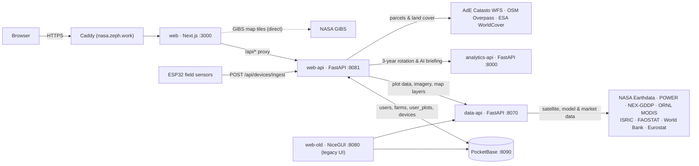

<div align="center">

  <h1>🌾 <code>ceres</code> 🛰️</h1>

  <p>
    <strong>Crop rotation decision support for farmers — combining NASA Earth observations, cadastral boundaries, on-field IoT sensors, and deterministic agronomy.</strong>
  </p>

  <p>
    <a href="https://nasa.zeph.work"></a>
    <a href="https://www.spaceappschallenge.org/"></a>
    <a href="#-license"></a>
  </p>

</div>

**Ceres** helps farmers pick resilient 3-year crop rotations. Select a parcel from the Italian cadastre (or draw any field worldwide), inspect what NASA and partner datasets say about its weather, water, soil, terrain, 5-year crop history, climate projections, and local market prices, plug in live ESP32 field sensors, and compare rotation plans and profitability.

Live demo: **[nasa.zeph.work](https://nasa.zeph.work)**

---

## 🌟 Authors

- [@zeph](https://github.com/ZephyrCodesStuff)
- [@ardalc](https://github.com/ardlc-1212)
- [@erengrl](https://github.com/erengrl)
- [@CoderXYZ7](https://github.com/CoderXYZ7)

## 🏗️ Architecture



| Service | Folder | Port | What it does |
| --- | --- | --- | --- |
| `web` | [`web/app`](web/app) | `3000` (localhost, behind Caddy) | Next.js 16 UI: map workbench, farms & plots, and 4-tab plot workspace (**Field & Map**, **Water, Soil & Climate**, **Rotation Plan**, **Markets & Costs**). On **Rotation Plan**, farmers mark crops as *Grow* or *Never* to re-run the 3-year optimizer. Proxies `/api/*` to `web-api`. |
| `web-api` | [`api/web-api`](api/web-api) | `8081` | FastAPI backend: auth, farms, plots, Catasto/Overpass parcel discovery, plot analysis, and IoT device ingestion. Relays `data-api` and `analytics-api`. |
| `data-api` | [`api/data-api`](api/data-api) | `8070` (internal only) | Aggregates 15 field datasets (14 fetched sources + derived RUSLE erosion), multi-band satellite PNGs, and NASA GIBS map layers. See [its README](api/data-api/README.md). |
| `analytics-api` | [`api/analytics-api`](api/analytics-api) | `8000` (internal only) | Field ingestion parser, deterministic 3-year crop rotation optimizer, and plain-language Gemini briefing (with deterministic template fallback). See [its README](api/analytics-api/README.md). |
| `pocketbase` | [`pocketbase`](pocketbase) | `8090` (internal only) | SQLite database and auth. Schema managed in [`pocketbase/pb_migrations`](pocketbase/pb_migrations). |
| `web-old` | [`web/app-old`](web/app-old) | `8080` (internal only) | Legacy NiceGUI prototype, kept for reference. |

## ⚡ Quick Start

```bash
cp .env.example .env          # add a free NASA Earthdata login and optional GEMINI_API_KEY
docker compose up --build -d
```

- **Website:** `http://localhost:3000` (demo login: `marco@turinfarm.it` / `demo-farmer-2026`)
- **`web-api` docs:** `http://localhost:8081/docs`

> [!IMPORTANT]
> **NASA Earthdata setup:**
> 1. Create a free account at [urs.earthdata.nasa.gov](https://urs.earthdata.nasa.gov) and add `EARTHDATA_USERNAME` / `EARTHDATA_PASSWORD` to `.env`.
> 2. Authorize the **NASA GESDISC DATA ARCHIVE** application in your Earthdata profile (required for GPM IMERG rainfall).
>
> Without an Earthdata login, CMR/Earthdata-backed datasets return errors. `data-api` persists credentials and responses on its cache volume so subsequent redeploys keep working.

For local development per service, check the README inside each folder (e.g. `data-api`: `uv run uvicorn app.main:app --port 8070`, `web`: `bun dev`).

## 🛰️ Data & Capabilities

Full field-by-field reference: [`docs/tech/data-catalog.md`](docs/tech/data-catalog.md) (CSV: [`docs/tech/data-catalog.csv`](docs/tech/data-catalog.csv)). Web integration guide: [`docs/tech/data-api-for-web.md`](docs/tech/data-api-for-web.md).

- **Weather & climate:** Temperature, humidity, dew point, wind, solar radiation, daylight hours, growing degree days (GDD), 1991–2020 normals, last-365-day extremes, and series aggregated into **24 half-month periods**.
- **Water:** Satellite rainfall (IMERG), surface & root-zone soil moisture (SMAP L4), crop evapotranspiration & evaporative stress index (ECOSTRESS 70 m + MODIS 500 m backup), and regional groundwater storage anomaly (GRACE-FO).
- **Crop health & history:** 30 m NDVI / NDMI / NDRE, within-field patchiness, and **5-year inferred crop history** derived from HLS phenology curves.
- **Soil & terrain:** Texture, organic carbon, pH, nitrogen, CEC, bulk density (SoilGrids); elevation, slope, field gradient, aspect, and low-spot waterlogging risk (NASADEM); **RUSLE topsoil erosion risk**.
- **Climate projections:** 2030s and 2050s rainfall, heat days, dry spells, water balance, and **drought risk** (NEX-GDDP-CMIP6 under SSP2-4.5 & SSP5-8.5).
- **Markets & yields:** EU/Italian farm-gate crop selling prices, electricity, gas, and diesel; global oil, fertilizer, and grain prices (World Bank); national yields and production (FAOSTAT).
- **Imagery & map layers:** Parcel-clipped true color, color infrared, SWIR agriculture/moisture, NDVI, NDMI, NDRE, thermal, LST, elevation, hillshade, and slope PNGs, plus 14 NASA GIBS WMTS tile layers.
- **On-field IoT:** Live ESP32 sensor readings (soil moisture, humidity, temperature) ingested via `POST /api/devices/ingest`.

> [!NOTE]
> Inputs not available from public satellites/APIs—such as local seed prices, irrigation water costs/connections, and exact crop varieties—are provided or overridden directly by the farmer.

## 📁 Repository Layout

```text
api/
  data-api/        NASA + global datasets for a field (FastAPI)
  web-api/         Website REST backend, Catasto & IoT ingestion (FastAPI)
  analytics-api/   Field parser, 3-year rotation optimizer & AI briefing (FastAPI)
web/
  app/             Next.js 16 frontend (Ceres)
  app-old/         Legacy NiceGUI prototype
pocketbase/
  pb_migrations/   Database schema migrations
docs/
  tech/            Data catalog & web API integration docs
  science/         LaTeX scientific documentation
  external/        Agenzia delle Entrate WFS specification
scripts/           Demo IoT seeding & deployment scripts
compose.yaml       Full multi-service Docker Compose stack
```

## 📚 Data Sources & Credits

### NASA Resources

| Dataset / Service | Provider / System | Endpoint / Resource |
| --- | --- | --- |
| Earthdata Login (auth) | NASA EOSDIS | https://urs.earthdata.nasa.gov |
| CMR Granule Search | NASA Earthdata | https://cmr.earthdata.nasa.gov/search/granules.umm_json |
| CMR-STAC (`LPCLOUD`) | NASA Earthdata / LP DAAC | https://cmr.earthdata.nasa.gov/stac/LPCLOUD/search |
| NASA POWER (daily & climatology) | NASA LaRC POWER | https://power.larc.nasa.gov/api/temporal/daily/point |
| GPM IMERG Late Run V07 (`GPM_3IMERGDL`) | NASA GES DISC (via CMR) | https://cmr.earthdata.nasa.gov/search/granules.umm_json |
| SMAP L4 Soil Moisture (`SPL4SMGP`) | NASA NSIDC DAAC (via CMR) | https://cmr.earthdata.nasa.gov/search/granules.umm_json |
| GRACE / GRACE-FO Mascon RL06.3 CRI | NASA JPL / PO.DAAC (via CMR) | https://cmr.earthdata.nasa.gov/search/granules.umm_json |
| HLS v2.0 (`HLSS30_2.0`, `HLSL30_2.0`) | NASA LP DAAC (via CMR-STAC) | https://cmr.earthdata.nasa.gov/stac/LPCLOUD/search |
| ECOSTRESS v2 (`L2T LSTE`, `L3T JET`, `L4T ESI`) | NASA LP DAAC (via CMR-STAC) | https://cmr.earthdata.nasa.gov/stac/LPCLOUD/search |
| NASADEM 1-arcsecond (`NASADEM_HGT_001`) | NASA LP DAAC (via CMR-STAC) | https://cmr.earthdata.nasa.gov/stac/LPCLOUD/search |
| MODIS MOD16A2 v6.1 (8-day ET/PET) | ORNL DAAC MODIS Web Service | https://modis.ornl.gov/rst/api/v1/MOD16A2/subset |
| NEX-GDDP-CMIP6 Climate Projections | NASA NCCS THREDDS | https://ds.nccs.nasa.gov/thredds |
| Global Imagery Browse Services (GIBS) | NASA EOSDIS | https://gibs.earthdata.nasa.gov/wmts/epsg3857/best/1.0.0/WMTSCapabilities.xml |

### Partners & Open Data

- **ISRIC SoilGrids 2.0** (CC BY 4.0) — https://files.isric.org/soilgrids/latest/data & https://rest.isric.org/soilgrids/v2.0/properties/query
- **Cartografia Catastale** — Agenzia delle Entrate (CC BY 4.0): [WMS](https://wms.cartografia.agenziaentrate.gov.it/inspire/wms/ows01.php) & [WFS](https://wfs.cartografia.agenziaentrate.gov.it/inspire/wfs/owfs01.php)
- **ESA WorldCover 2021** (CC BY 4.0) — https://esa-worldcover.s3.eu-central-1.amazonaws.com/v200/2021/map
- **FAOSTAT** — Food and Agriculture Organization of the United Nations: https://bulks-faostat.fao.org/production/
- **World Bank Commodity Price Data (Pink Sheet)** — https://www.worldbank.org/en/research/commodity-markets
- **Eurostat & European Commission** (EU crop/energy prices & Weekly Oil Bulletin) — https://ec.europa.eu/eurostat/api/dissemination/statistics/1.0/data, https://energy.ec.europa.eu/data-and-analysis/weekly-oil-bulletin_en, https://ec.europa.eu/agrifood/api
- **OpenStreetMap** (© OpenStreetMap contributors, ODbL) — [Overpass API](https://overpass-api.de/api/interpreter), [Nominatim](https://nominatim.openstreetmap.org/reverse), & standard map tiles
- **Photon (Komoot)** location search — https://photon.komoot.io/api/
- **Esri World Imagery** basemap — https://server.arcgisonline.com/ArcGIS/rest/services/World_Imagery/MapServer/tile/{z}/{y}/{x}

> [!NOTE]
> **Scientific transparency:** Calculations use deterministic agronomic models—FAO-56 water balance, RUSLE (Renard et al.), EPIC soil erodibility (Williams), and Hargreaves reference ET. Recommendations are advisory and support, rather than replace, local agronomist and farmer judgment.

## 📄 License

Dual-licensed under [Apache 2.0](LICENSE-APACHE) and [MIT](LICENSE-MIT). See [LICENSE](LICENSE) for details.
